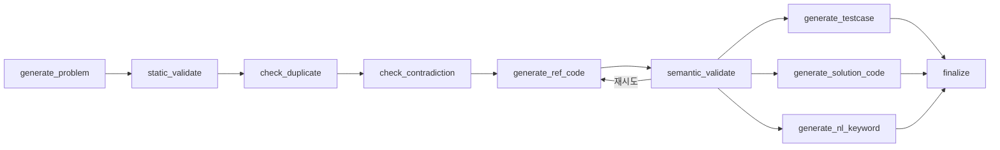

# COSMOS AI Server 

개인화 알고리즘 학습 서비스 [COSMOS](https://cosmoscode.site)의 AI 서버다.
코딩 테스트 문제를 생성하고, 실제로 풀리는 문제인지 코드 실행으로 검증한 뒤 백엔드(Spring)에 전달한다.
배틀 문제 생성과 서술형 풀이 채점도 담당한다.

---

## 문제 생성 흐름

화살표는 앞 단계를 통과한 문제만 다음 단계로 넘어간다는 뜻이다. 어느 단계에서든 걸리면 폐기 로그에 남기고 종료한다.



## 모듈별 역할

### `problem`: 문제 생성 그래프

- 배치와 온디맨드 API가 같은 LangGraph 그래프를 사용함
- `generate_problem`: 같은 난이도·카테고리의 시드 문제를 few-shot으로 넣어 문제를 생성함. 배치에서는 vLLM 모델을 먼저 쓰고 실패하면 Gemini로 폴백함
- `static_validate`: 필수 필드, 난이도 일치, 예시 출력 자료형, 제약 범위를 규칙으로 검사함
- `check_duplicate`: `algorithm_core`를 768차원으로 임베딩해 같은 카테고리 문제와 비교하고, 코사인 유사도 0.87 이상이면 폐기함
- `check_contradiction`: 지문 내부, 지문과 제약 조건 사이의 모순을 LLM으로 검사함
- `generate_ref_code` → `semantic_validate`: 파이썬 레퍼런스 코드를 Judge0에서 공개 예시로 실행해 출력을 비교함. 실패하면 레퍼런스 코드만 다시 만들며, 같은 실패가 반복되거나 3회를 넘으면 폐기함
- `generate_testcase`, `generate_solution_code`, `generate_nl_keyword`: 검증을 통과한 문제에만 병렬로 실행함. 히든 테스트 정답은 LLM이 아닌 레퍼런스 코드 실행 결과로 채움

### `problem/battle`: 배틀 문제 생성

- 코드 대신 출력값을 맞히는 문제라 별도 그래프를 사용함
- 기대 출력은 검증용 코드를 Judge0로 실행해 채우고, 유사도 0.85 이상이면 중복으로 폐기함

### `problem/evaluation`: 서술형 풀이 채점

- 접근 방식 40점, 카테고리 20점, 핵심 키워드 30점, 설명 순서 10점을 항목별로 채점해 합산함
- 내용이 없는 풀이에는 점수를 주지 않음

### `batch`: 문제 재고 보충

- FastAPI 프로세스 안에서 APScheduler로 실행하며, `BATCH_ENABLED`인 서버에서만 동작함
- 12:00 생성: Spring에서 조합별 미풀이 재고를 조회하고, 조합마다 3개가 유지되도록 일반·데일리·배틀 문제를 생성함
- 15:00 전송: 전송 버퍼의 문제를 20개씩 Spring에 보냄. 일시 오류는 1분·5분·15분 뒤 재시도하고, 거부되면 한 건씩 나눠 보내 거부된 문제만 제외함
- 생성과 전송은 서로 다른 PostgreSQL advisory lock을 잡아, 컨테이너가 여러 개 떠 있어도 한 곳에서만 실행됨

## API

Spring에서만 호출하는 내부 API다. 검증에서 폐기되면 502로 응답한다.

| 메서드 | 경로 | 설명 |
| --- | --- | --- |
| POST | `/api/llm/problem` | 문제 1개 온디맨드 생성 |
| POST | `/api/llm/problem/daily` | 데일리 문제 5개 생성 |
| POST | `/api/llm/problem/battle` | 배틀 문제 1개 생성 |
| POST | `/api/llm/evaluation` | 서술형 풀이 채점 |
| GET | `/api/admin/batch/plan` | 생성 배치 계획 조회 |
| POST | `/api/admin/batch/generate`, `/api/admin/batch/send` | 배치 수동 실행 |

## 데이터베이스

PostgreSQL 17 + pgvector. AI 서버의 작업 데이터만 저장하며, 서비스 문제 DB는 Spring이 소유한다.

| 테이블 | 관리 주체 | 용도 |
| --- | --- | --- |
| `generated_problems` | `finalize` | 검증을 통과한 전송 대기 문제 |
| `discarded_problems` | `discard_problem` | 폐기 단계와 사유 |
| `problem_embeddings` | `check_duplicate` | 중복 검사용 임베딩 |
| `fewshot_seeds` | `generate_problem` | few-shot 시드 문제 |
| `battle_problems`, `battle_problem_embeddings` | `problem/battle` | 배틀 문제 버퍼와 임베딩 |

## 외부 통신

| 대상 | 용도 |
| --- | --- |
| Spring | 재고 조회, 생성 문제 전송 |
| Judge0 | 레퍼런스 코드 실행, 히든 테스트 출력 산출 |
| Gemini API | 노드별 생성·검증 LLM 호출, 임베딩 |
| vLLM | 배치 문제 생성 (AWS SSM에 등록된 모델) |
| Langfuse | 노드별 트레이스, 프롬프트 버전 관리 |

---

## 빠른 시작 (로컬 개발 및 평가)

```bash
# 1. 의존성 설치
uv sync --extra dev

# 2. 로컬 PostgreSQL 기동 및 마이그레이션
docker compose up -d
uv run alembic upgrade head

# 3. 운영 기준 Few-shot 시드 데이터 80건 적재 (최초 1회)
uv run python -m src.db.seed_fewshot

# 4. FastAPI 서버 기동
uv run uvicorn src.main:app --reload --port 8000
```

```bash
# 테스트 및 린트
uv run pytest
uv run ruff check .
```

모델 평가 하네스(`evals.generate` → `evals.score` → `evals.summarize`) 및 GitHub Actions 자동화 파이프라인의 상세 사용법은 [`docs/LLMOPS_GUIDE.md`](docs/LLMOPS_GUIDE.md)를 참고한다.

---

## 주요 문서

- [AI 설계 문서](https://github.com/100-hours-a-week/KTB4-9th-wiki/wiki/AI%E2%80%90Wiki)
- [모델 평가 및 LLMOps 사용 가이드](docs/LLMOPS_GUIDE.md)
