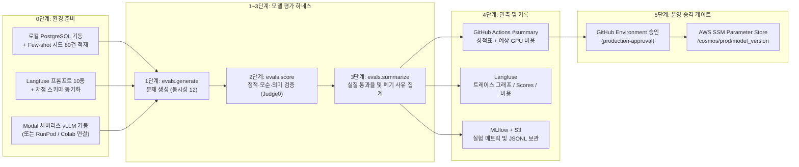

# COSMOS AI 모델 평가 및 LLMOps 사용 가이드

본 문서는 COSMOS AI 팀원이 코딩 테스트 문제 생성 모델을 평가하고, 프롬프트와 트레이스를 관측하며, 검증된 모델을 운영 환경에 배포하는 전체 절차와 사용법을 설명한다.

---

## 목차

1. [한눈에 보는 COSMOS LLMOps 파이프라인](#1-한눈에-보는-cosmos-llmops-파이프라인)
2. [GitHub Actions 원클릭 모델 평가 사용법](#2-github-actions-원클릭-모델-평가-사용법)
3. [로컬 환경(Mac + RunPod / Modal)에서 직접 실행하는 법](#3-로컬-환경mac--runpod--modal에서-직접-실행하는-법)
4. [Langfuse 대시보드 및 프롬프트 관리 활용법](#4-langfuse-대시보드-및-프롬프트-관리-활용법)
5. [MLflow 실험 비교 및 결과 원본 다운로드](#5-mlflow-실험-비교-및-결과-원본-다운로드)
6. [우수 모델 운영 배포 승격 및 롤백 방법](#6-우수-모델-운영-배포-승격-및-롤백-방법)
7. [자주 묻는 질문 및 트러블슈팅](#7-자주-묻는-질문-및-트러블슈팅)

---

## 1. 한눈에 보는 COSMOS LLMOps 파이프라인

COSMOS LLMOps 파이프라인은 72건의 표준 평가 요청(`evals/requests_v1.jsonl`)을 기준으로 후보 모델의 문제 생성 품질을 정량 평가하고, 기준을 통과한 모델만 운영 배치에 반영한다.



### 실행 방식 선택 기준

| 구분 | GitHub Actions 원클릭 자동 평가 | 로컬 PC + 클라우드 GPU 수동 평가 |
|---|---|---|
| **추천 상황** | 파인튜닝 완료 모델의 정식 72건 평가, 베이스 모델 벤치마크, 운영 배포 승격 | 프롬프트 수정 중 빠른 반복 실험, 이미 띄워둔 RunPod / Colab 인스턴스 활용 |
| **DB 및 시드** | 워크플로가 `pgvector` 컨테이너를 띄우고 시드 80건을 자동 적재함 | 로컬 Docker Postgres에 시드 적재 명령어 1회 실행 |
| **GPU 인프라** | Modal 서버리스 GPU가 자동 배포·기동되며 유휴 시 0대로 자동 축소됨 | 팀원이 띄운 RunPod / Modal / Colab 주소를 `.env`의 `VLLM_URL`에 기입 |
| **결과 확인** | GitHub Actions `#summary` 리포트, Langfuse, MLflow, 디스코드 알림 자동 발행 | 로컬 `evals/results/<label>/summary.md` 및 Langfuse에서 확인 |

---

## 2. GitHub Actions 원클릭 모델 평가 사용법

로컬에 무거운 환경을 세팅할 필요 없이 GitHub 웹 화면에서 버튼 클릭 한 번으로 전체 평가를 수행할 수 있다.

### 2.1 실행 절차

1. GitHub 저장소 상단 탭에서 **`Actions`**를 클릭한다.
2. 좌측 워크플로 목록에서 **`LLMOps Evaluation & Release`**를 선택한다.
3. 우측의 **`Run workflow`** 버튼을 누르고 아래 표를 참고하여 입력값을 설정한 뒤 실행한다.

### 2.2 입력 파라미터 상세 안내

| 파라미터 | 기본값 | 설명 및 입력 가이드 |
|---|---|---|
| `track_type` | `base_model` | • `base_model`: 비학습 오픈소스 베이스 모델 평가 시 선택<br>• `trained_model`: 직접 파인튜닝하여 HuggingFace에 업로드한 모델 평가 시 선택 |
| `model_id` | `Qwen/Qwen3.5-122B-A10B-FP8` | 평가할 HuggingFace 모델 레포지토리 ID를 입력한다.<br>예: `Qwen/Qwen3-32B`, `your-hf-id/cosmos-qwen3-8b-merged` |
| `prompt_version` | `generate_problem/v11` | 리포트 및 MLflow에 기록할 프롬프트 버전 식별자다. |
| `gpu_type` | `H200` | 추론에 사용할 Modal 서버리스 GPU 기종을 선택한다. (아래 GPU 선택 표 참고) |
| `limit` | `0` | • **`0`**: 72건 전체 정식 평가 (약 15~20분 소요)<br>• **`4`**: 파이프라인 동작 확인용 스모크 테스트 (약 4~5분 소요) |
| `concurrency` | `12` | vLLM에 동시에 보낼 문제 생성 요청 수다. `H200` 기준 `12`가 최적이다. |

### 2.3 모델 크기별 추천 GPU 기종 및 단가

| GPU 기종 | VRAM | 시간당 단가 | 권장 모델 체급 |
|---|---|---|---|
| **`H200`** (기본값) | 141GB HBM3e | `$4.54 / hr` | `122B-FP8`, `70B~72B` 대형 모델, 고속 연속 배치 추론 |
| **`B200`** | 180GB HBM3e | `$6.25 / hr` | 초대형 모델 또는 대규모 배치 추론 |
| **`2xA100`** | 160GB (80GB×2) | `$5.00 / hr` | 텐서 병렬(`TP=2`) 분산 추론이 필요한 대형 모델 |
| **`A100`** | 80GB | `$2.50 / hr` | `14B ~ 32B` 병합 모델 |
| **`L40S`** | 48GB | `$1.95 / hr` | `7B ~ 14B` 모델 |
| **`L4`** | 24GB | `$0.80 / hr` | `4B ~ 8B` 소형 모델 또는 양자화 모델 |

### 2.4 평가 결과 리포트 확인 (`#summary`)

워크플로 실행이 끝나면 해당 GitHub Actions 실행 화면 하단의 **`Summary`** 영역에 다음 항목이 포함된 성적표가 자동으로 출력된다.

1. **실행 환경 및 GPU 인프라 비용 카드**:
   - 평가 모델명, 트랙 유형, 프롬프트 버전
   - 사용한 GPU 기종 및 시간당 단가
   - 1단계 문제 생성 실제 소요 시간 및 **예상 GPU 과금액(USD)**
   - **실질 통과율** 및 **Langfuse 세션·트레이스 바로가기 링크**
2. **상세 평가 비교표 (`evals.summarize` 출력)**:
   - **요약표**: 확정/전체 건수, 검증 통과율, 실행 제한 비정상 건수, **실질 통과율(95% 신뢰구간)**, 단계별 폐기율(`생성 형식 실패`, `정적 검증 폐기`, `모순 검사 폐기`, `의미 검증 폐기`), 생성 시간 `p50 / p90`
   - **폐기 사유 집계표**: 어떤 단계의 어떤 사유(예: `semantic_validate / REF_CODE_FAILED`, `check_contradiction / PROBLEM_CONTRADICTION`)로 몇 건이 폐기되었는지 집계
   - **난이도별 / 카테고리별 실질 통과율**: `LV1~LV5` 난이도 및 `DP`, `GREEDY`, `GRAPH` 등 16개 카테고리별 통과율 분석

---

## 3. 로컬 환경(Mac + RunPod / Modal)에서 직접 실행하는 법

팀원이 본인 PC에서 프롬프트를 수정하거나, 이미 띄워둔 RunPod·Modal·Colab GPU 서버를 연결해 직접 평가를 돌리고 싶을 때 사용한다.

### 3.1 로컬 PostgreSQL 기동 및 Few-shot 시드(80건) 적재

문제 생성 노드(`generate_problem`)는 DB의 `fewshot_seeds` 테이블에서 같은 난이도·카테고리의 참고 문제를 조회한다. 시드가 비어 있으면 참고 문제 없이 생성되어 품질이 달라지므로, **최초 1회 반드시 시드 80건을 로컬 DB에 적재**해야 한다.

```bash
# 1. 로컬 PostgreSQL 컨테이너 실행 (이미 떠 있다면 생략)
docker compose up -d

# 2. DB 스키마 최신 마이그레이션 적용
uv run alembic upgrade head

# 3. 운영 DB 기준 Few-shot 시드 데이터 80건(16개 카테고리 × 5개 난이도) 적재
uv run python -m src.db.seed_fewshot
```

> **참고**: Python 스크립트 대신 SQL 파일로 직접 넣으려면 아래 명령어를 사용할 수도 있다.
> `psql -h localhost -U cosmos -d cosmos -f sql/seed_fewshot_data.sql`

### 3.2 클라우드 GPU 추론 서버 연결 (`.env` 설정)

로컬 `.env` 파일에 추론 서버 주소와 API 키를 설정한다.

```dotenv
# vLLM 추론 서버 주소 (끝에 /v1 유무와 상관없이 자동 보정됨)
VLLM_URL=https://your-gpu-endpoint.modal.run
VLLM_API_KEY=your-secret-api-key

# 2단계 채점(모순 검사, 테스트케이스·레퍼런스 코드 생성, Judge0 실행)용 필수 설정
GEMINI_API_KEY=your-gemini-api-key
JUDGE0_URL=https://stage-judge.cosmoscode.site

# Langfuse 관측성 연동 (선택 사항이나 켜두는 것을 권장)
LANGFUSE_PUBLIC_KEY=pk-lf-...
LANGFUSE_SECRET_KEY=sk-lf-...
LANGFUSE_HOST=https://jp.cloud.langfuse.com
```

- **RunPod / 자체 vLLM 서버를 띄울 때 권장 옵션**:
  - Few-shot 예시 3개(약 2,000 토큰)와 문제 JSON 출력(약 2,500 토큰)이 잘리지 않도록 **`--max-model-len 8192`** 이상으로 설정한다.
  - Qwen3 / Qwen3.5 계열 모델은 `<think>` 추론 토큰 노출로 인한 JSON 파싱 실패를 막기 위해 서버 기동 옵션에 `--default-chat-template-kwargs '{"enable_thinking": false}'`를 주거나 생성 명령어에 `--chat-template-kwargs '{"enable_thinking": false}'`를 넘긴다.
- **Modal에 새 모델을 직접 배포할 때**:
  ```bash
  # (선택) 새 모델 가중치를 Modal 볼륨(cosmos-model-cache)에 사전 다운로드
  uv run --with modal modal run download_model.py --model-id "Qwen/Qwen3-32B"

  # Modal 서버리스 vLLM 엔드포인트 배포 (기본 GPU: H200)
  MODEL_ID="Qwen/Qwen3-32B" MODAL_GPU_TYPE="A100" uv run --with modal modal deploy modal_serve.py
  ```

### 3.3 3단계 평가 하네스 실행 명령어

평가는 **1단계(생성) → 2단계(채점) → 3단계(요약 및 비교)** 순서로 실행한다. 1단계 생성이 끝나면 GPU 서버(RunPod/Colab 등)를 즉시 종료해도 2·3단계를 진행할 수 있어 GPU 비용을 아낄 수 있다.

#### ① 1단계: 문제 생성 (`evals.generate`)
```bash
# 앞 4건만 빠르게 스모크 테스트
uv run python -m evals.generate \
  --label qwen3-8b-smoke \
  --model your-hf-id/cosmos-qwen3-8b-merged \
  --chat-template-kwargs '{"enable_thinking": false}' \
  --concurrency 12 \
  --limit 4

# 72건 전체 정식 생성 (--limit 생략)
uv run python -m evals.generate \
  --label qwen3-8b-v1 \
  --model your-hf-id/cosmos-qwen3-8b-merged \
  --chat-template-kwargs '{"enable_thinking": false}' \
  --concurrency 12
```
- 결과는 `evals/results/<label>/generations.jsonl`에 한 줄씩 저장된다.

#### ② 2단계: 생성된 문제 채점 (`evals.score`)
```bash
uv run python -m evals.score \
  --label qwen3-8b-v1 \
  --concurrency 8
```
- 1단계에서 생성된 문제를 그래프에 주입하여 **정적 검증(`static_validate`) → 논리 모순 검사(`check_contradiction`) → 테스트케이스·레퍼런스 코드 생성 → Judge0 실행(`semantic_validate`)**을 수행한다.
- 결과는 `evals/results/<label>/scores.jsonl`에 저장된다.

#### ③ 3단계: 성적표 산출 및 여러 모델 1:1 짝 비교 (`evals.summarize`)
```bash
# 단일 모델 성적표 출력 및 마크다운 저장
uv run python -m evals.summarize qwen3-8b-v1 --out evals/results/qwen3-8b-v1/summary.md

# 여러 모델 비교 (첫 번째 label을 기준으로 요청별 1:1 짝 비교표까지 자동 생성)
uv run python -m evals.summarize gemini-baseline qwen3-8b-base qwen3-8b-v1 \
  --diversity \
  --out comparison.md
```
- `--diversity` 옵션을 붙이면 생성된 문제들의 `algorithm_core` 임베딩 코사인 유사도를 계산해 **앞선 문제와의 중복 비율(유사도 ≥ 0.87)**까지 표에 함께 출력한다.

---

## 4. Langfuse 대시보드 및 프롬프트 관리 활용법

모든 평가 실행과 LLM 호출은 Langfuse에 자동으로 기록되며, 모델 성능 분석과 폐기 원인 디버깅에 활용할 수 있다.

### 4.1 주요 대시보드 바로가기 링크

| 메뉴 | 바로가기 링크 | 주요 확인 정보 |
|---|---|---|
| **홈 대시보드** | [프로젝트 홈 열기](https://jp.cloud.langfuse.com/project/cmvn9ym2z000bad0le09b0n4i) | 모델별 호출 건수·비용(`Qwen`, `Gemini`), 채점 점수 추이, 프롬프트 버전별 지연 시간(`p50/p90/p99`) |
| **평가 세션 목록** | [Sessions 탭 열기](https://jp.cloud.langfuse.com/project/cmvn9ym2z000bad0le09b0n4i/sessions) | 평가 실행 단위(`eval-<run_id>` 또는 로컬 `--label`)별 전체 통과율 및 총 GPU 비용 |
| **트레이스 & 점수** | [Traces 탭 열기](https://jp.cloud.langfuse.com/project/cmvn9ym2z000bad0le09b0n4i/traces?filter=isRootObservation%3Bboolean%3B%3B%3D%3Btrue&traceTab=scores&view=graph) | 개별 문제의 1단계 생성 + 2단계 채점 통합 그래프 및 단계별 폐기 사유 |
| **프롬프트 보관함** | [Prompts 탭 열기](https://jp.cloud.langfuse.com/project/cmvn9ym2z000bad0le09b0n4i/prompts) | COSMOS 전체 노드 프롬프트 10종의 템플릿 원문, 버전, 연결된 추론 통계 |

### 4.2 Langfuse에서 폐기된 문제 디버깅하는 법

1. GitHub Actions 요약 화면의 **`트레이스 그래프 및 점수 보기`** 링크를 클릭하거나 Langfuse `Traces` 탭으로 이동한다.
2. 각 문제 트레이스(`eval-xxx:v1-0001:LV3:GREEDY`)는 **1단계 생성(`generate`)과 2단계 채점(`score`)이 하나의 트레이스로 묶여 있다.**
3. 트레이스를 클릭한 뒤 우측 상단에서 **`Graph` 뷰**와 **`Scores` 탭**을 켜면 다음 정보를 즉시 확인할 수 있다:
   - **`passed`**: `1` (최종 통과) 또는 `0` (폐기)
   - **`outcome`**: 통과 시 `PASSED`, 폐기 시 `폐기단계:폐기사유` (예: `semantic_validate:EXAMPLE_MISMATCH`, `check_contradiction:PROBLEM_CONTRADICTION`)와 상세 코멘트
   - **`gpu_cost_usd`**: 해당 문제 1건을 생성하는 데 소모된 GPU 과금액
   - **노드별 입출력**: 그래프에서 `generate_problem`, `check_contradiction`, `generate_ref_code`, `semantic_validate` 노드를 클릭하면 실제로 들어간 프롬프트와 모델이 뱉은 응답 전문을 확인할 수 있다.

### 4.3 프롬프트 수정 및 Langfuse 동기화 방법

코드베이스 내 각 노드의 프롬프트 상단에 있는 `PROMPT_VERSION` 상수가 Langfuse의 프롬프트 레지스트리와 자동으로 연결된다.

| 노드 파일 경로 | 프롬프트 이름 | 현재 버전 상수 |
|---|---|---|
| `src/problem/nodes/generate_problem.py` | `generate_problem` | `generate_problem/v11` |
| `src/problem/nodes/check_contradiction.py` | `check_contradiction` | `check_contradiction/v1` |
| `src/problem/nodes/generate_testcase.py` | `generate_testcase` | `generate_testcase/v2` |
| `src/problem/nodes/generate_ref_code.py` | `generate_ref_code` | `generate_ref_code/v4` |
| `src/problem/nodes/generate_solution_code.py` | `generate_solution_code` | `generate_solution_code/v1` |
| `src/problem/nodes/generate_nl_keyword.py` | `generate_nl_keyword` | `generate_nl_keyword/v1` |
| `src/problem/battle/nodes.py` | `generate_battle_problem` | `generate_battle_problem/v3` |
| `src/problem/evaluation.py` | `evaluate_nl_solution` | `evaluate_nl_solution/v2` |

프롬프트 내용을 수정했을 때는 다음 순서를 따른다:
1. 해당 파이썬 파일에서 프롬프트 문자열을 수정하고 `PROMPT_VERSION`의 버전 번호를 올린다 (예: `generate_problem/v12`).
2. 로컬에서 즉시 Langfuse에 새 프롬프트 버전을 등록하려면 아래 명령어를 실행한다 (GitHub Actions에서는 0.2단계에서 자동으로 실행됨):
   ```bash
   uv run python -m src.client.langfuse_setup
   ```

---

## 5. MLflow 실험 비교 및 결과 원본 다운로드

1. **MLflow 대시보드 (`https://mlflow.cosmoscode.site`)**:
   - `cosmos-model-eval` 실험 아래에 각 실행이 기록된다.
   - 기록되는 파라미터: `model_id`, `track_type`, `prompt_version`, `gpu_type`, `label`, `git_sha`
   - 기록되는 메트릭: `usable_rate`(실질 통과율), `pass_rate`(검증 통과율), `format_fail_rate`, `static_discard_rate`, `contradiction_discard_rate`, `semantic_discard_rate`, `generation_wall_seconds`, `estimated_gpu_cost_usd`
2. **결과 원본 파일 (`generations.jsonl`, `scores.jsonl`, `summary.json`, `summary.md`) 다운로드**:
   - **GitHub Actions 화면**: 워크플로 실행 화면 하단 `Artifacts` 섹션에서 `eval-results-<track_type>-<run_id>` 압축 파일을 클릭해 바로 내려받을 수 있다.
   - **S3 버킷**: `s3://cosmos-v2-stage-mlflow-artifacts-352635536602/evals/eval-<label>/` 경로에 불변 아티팩트로 영구 보관된다.

---

## 6. 우수 모델 운영 배포 승격 및 롤백 방법

### 6.1 운영 배포 승격 (`Promote Approved Model`)

1. GitHub Actions에서 `evaluate` 잡이 완료되면, 두 번째 잡인 **`Promote Approved Model to AWS SSM Parameter Store`**가 실행 대기 상태가 되며 디스코드로 알림이 발송된다.
2. `#summary` 리포트의 실질 통과율과 폐기 사유를 검토한 뒤, 이 모델을 운영 배치에 적용하기로 결정했다면 GitHub Actions 화면 상단의 노란색 배너에서 **`Review deployments`** 버튼을 클릭한다.
3. `production-approval` 체크박스를 선택하고 코멘트를 남긴 뒤 **`Approve and deploy`**를 누른다.
4. 승인 즉시 AWS SSM Parameter Store의 `/cosmos/prod/model_version` 값이 해당 `model_id`로 업데이트된다.
5. 백엔드/AI 서버는 **코드 수정이나 컨테이너 재배포 없이**, 매일 새벽 01:00 KST 정기 배치 실행 시 SSM에서 최신 모델명을 읽어 해당 모델로 문제를 생성한다.

### 6.2 긴급 롤백 및 안전장치

- **자동 폴백 안전장치**: 운영 배치 실행 중 vLLM 서버에 일시적인 장애나 출력 파싱 오류가 발생하면, `call_llm_with_fallback` 로직에 의해 **배치가 중단되지 않고 즉시 기본 Gemini 모델로 자동 폴백**하여 문제를 생성한다.
- **이전 모델로 수동 롤백**: 특정 모델로 승격한 뒤 이전 모델로 되돌리고 싶다면, AWS SSM Parameter Store의 `/cosmos/prod/model_version` 값을 이전 모델 ID로 수정하거나 파라미터를 삭제하면 즉시 기본 상태로 복구된다.

---

## 7. 자주 묻는 질문 및 트러블슈팅

### Q1. 생성이나 채점 도중에 네트워크 오류나 Judge0 일시 장애가 발생해 몇 건이 실패했습니다. 처음부터 다시 돌려야 하나요?
- **아니다.** `evals.generate`와 `evals.score`는 이미 성공한 요청을 자동으로 건너뛰는 이어 돌리기 기능을 지원한다.
- 같은 `--label`에 **`--retry-errors`** 옵션을 붙여 다시 실행하면, 모델 탓이 아닌 인프라 에러(`APIConnectionError`, 타임아웃, `LLM_ERROR`, `EXECUTOR_ERROR`)로 끝난 요청만 골라서 다시 실행한다.
  ```bash
  # 1단계 생성 중 인프라 에러로 실패한 건만 재시도
  uv run python -m evals.generate --label qwen3-8b-v1 --model ... --retry-errors

  # 2단계 채점 중 Judge0/Gemini 일시 장애로 실패한 건만 재시도
  uv run python -m evals.score --label qwen3-8b-v1 --retry-errors
  ```

### Q2. 제가 파인튜닝한 모델을 HuggingFace에 비공개로 올렸는데 GitHub Actions에서 평가할 수 있나요?
- 가능하다. Modal 시크릿(`cosmos-modal-secret`)에 등록된 `HF_TOKEN`이 해당 비공개 레포지토리 읽기 권한을 가지고 있으면 자동으로 다운로드된다.
- 단, LoRA 어댑터만 올라간 레포지토리가 아니라 **베이스 모델과 병합된 전체 가중치 모델**로 업로드하면 `model_id`에 레포지토리 이름만 넣어도 즉시 vLLM에서 서빙된다.

### Q3. `검증 통과율`과 `실질 통과율`의 차이는 무엇인가요?
- **검증 통과율 (`pass_rate`)**: 정적 검증, 모순 검사, 의미 검증(Judge0 레퍼런스 코드 통과)을 모두 통과한 비율이다.
- **실질 통과율 (`usable_rate`)**: 검증을 통과한 문제 중에서 **메모리 제한(`32MB ~ 2GB`)과 시간 제한(`100ms ~ 20초`)까지 정상 범위 안에 들어와 실제 서비스에 바로 출제할 수 있는 문제의 비율**이다. 소형 모델이 간혹 `메모리 제한 1MB`처럼 비현실적인 제한값을 생성하는 경우를 걸러내기 위해 핵심 지표로 사용한다.
