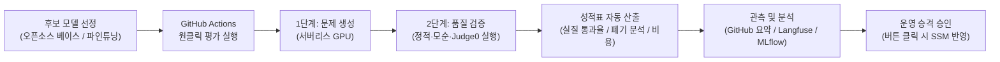

# COSMOS AI 모델 평가 및 LLMOps 사용자 가이드

본 문서는 COSMOS AI 팀원이 코딩 테스트 문제 생성 모델을 평가하고, 성능과 품질을 관측하며, 검증된 모델을 운영 서비스에 반영하는 전체 절차를 사용자 관점에서 설명한다.

---

## 목차

1. [파이프라인 개요](#1-파이프라인-개요)
2. [필요한 환경변수 및 GitHub Secrets 설정](#2-필요한-환경변수-및-github-secrets-설정)
3. [GitHub Actions 원클릭 모델 평가 실행](#3-github-actions-원클릭-모델-평가-실행)
4. [평가 결과 및 성적표 분석 방법](#4-평가-결과-및-성적표-분석-방법)
5. [Langfuse 대시보드 활용 및 프롬프트 관리](#5-langfuse-대시보드-활용-및-프롬프트-관리)
6. [MLflow 실험 지표 비교 및 결과 다운로드](#6-mlflow-실험-지표-비교-및-결과-다운로드)
7. [검증된 모델 운영 반영 및 롤백 절차](#7-검증된-모델-운영-반영-및-롤백-절차)
8. [자주 묻는 질문](#8-자주-묻는-질문)

---

## 1. 파이프라인 개요

COSMOS LLMOps 파이프라인은 72건의 표준 평가 요청을 기준으로 후보 모델의 문제 생성 능력을 정량 평가하고, 검증 기준을 통과한 모델만 운영 환경에 안전하게 배포할 수 있도록 지원한다.

---

## 2. 필요한 환경변수 및 GitHub Secrets 설정

모델 평가와 품질 검증 파이프라인이 정상 동작하려면 아래 환경변수들이 준비되어 있어야 한다. GitHub Actions를 통해 자동 평가를 진행할 때는 저장소의 **GitHub Secrets**에 등록되어 있어야 하며, 로컬 PC에서 테스트할 때는 루트 경로의 `.env` 파일에 기입한다.

### 2.1 GitHub Secrets 등록 위치
저장소 상단 메뉴의 **`Settings` → `Secrets and variables` → `Actions`** 경로에서 아래 항목들을 등록하거나 관리한다.

### 2.2 필수 환경변수 목록

| 환경변수 이름 | 등록 위치 | 용도 및 설명 |
|---|---|---|
| `MODAL_TOKEN_ID` | GitHub Secrets / `.env` | Modal 서버리스 GPU 인프라 구동 및 vLLM 엔드포인트 자동 배포를 위한 인증 ID |
| `MODAL_TOKEN_SECRET` | GitHub Secrets / `.env` | Modal API 접근용 비밀 키 |
| `HF_TOKEN` | GitHub Secrets / `.env` | HuggingFace 접근 토큰. 비공개 모델 가중치를 다운로드할 때 필수 사용 |
| `GEMINI_API_KEY` | GitHub Secrets / `.env` | 2단계 채점 과정에서 문제 논리 모순 검사, 테스트케이스 및 기준 코드 생성을 수행하기 위한 API 키 |
| `JUDGE0_URL` | GitHub Secrets / `.env` | 생성된 문제의 입출력 예시와 기준 코드를 직접 컴파일·실행하여 검증하는 채점 서버 주소 |
| `LANGFUSE_PUBLIC_KEY` | GitHub Secrets / `.env` | 추론 로그, 단계별 트레이스, 채점 결과, GPU 비용을 관측 플랫폼에 기록하기 위한 공개 키 |
| `LANGFUSE_SECRET_KEY` | GitHub Secrets / `.env` | Langfuse 데이터 전송용 비밀 키 |
| `LANGFUSE_HOST` | GitHub Secrets / `.env` | Langfuse 호스트 주소 (예: `https://jp.cloud.langfuse.com`) |
| `MLFLOW_TRACKING_URI` | GitHub Secrets / `.env` | 모델 평가 지표와 파라미터를 보관하고 비교하는 MLflow 서버 주소 |
| `AWS_ACCESS_KEY_ID` | GitHub Secrets / `.env` | MLflow 평가 결과 원본 파일 저장 및 운영 배포 승격을 위한 AWS 인증 키 |
| `AWS_SECRET_ACCESS_KEY` | GitHub Secrets / `.env` | AWS 비밀 인증 키 |
| `DISCORD_WEBHOOK_URL` | GitHub Secrets / `.env` | 평가 완료 성적표 및 운영 승인 요청 알림을 팀 채널로 전달하는 웹훅 주소 |

---

## 3. GitHub Actions 원클릭 모델 평가 실행

복잡한 인프라 설치나 로컬 환경 구성 없이 GitHub 웹 화면에서 파라미터 입력만으로 모델 평가를 시작할 수 있다.

### 3.1 실행 방법

1. GitHub 저장소 상단 메뉴에서 **`Actions`** 탭을 클릭한다.
2. 좌측 목록에서 **`LLMOps Evaluation & Release`** 워크플로를 선택한다.
3. 우측의 **`Run workflow`** 버튼을 누르고 필요한 항목을 설정한 뒤 실행한다.

### 3.2 입력 항목 안내

| 항목 이름 | 기본값 | 선택 및 입력 가이드 |
|---|---|---|
| `track_type` | `base_model` | • `base_model`: 오픈소스 원본 베이스 모델을 벤치마크할 때 선택 • `trained_model`: 직접 파인튜닝하여 HuggingFace에 올린 모델을 평가할 때 선택 |
| `model_id` | `Qwen/Qwen3.5-122B-A10B-FP8` | 평가할 HuggingFace 모델 레포지토리 이름 예: `Qwen/Qwen3-32B`, `your-org/cosmos-qwen3-8b-merged` |
| `prompt_version` | `generate_problem/v11` | 리포트 및 실험 기록에 표시할 프롬프트 버전 식별자 |
| `gpu_type` | `H200` | 추론을 수행할 클라우드 GPU 기종 (하단 추천 표 참고) |
| `limit` | `0` | • **`0`**: 72건 전체 정식 평가 (약 15~20분 소요) • **`4`**: 파이프라인 정상 동작 여부만 빠르게 확인하는 스모크 테스트 (약 4~5분 소요) |
| `concurrency` | `12` | 동시에 처리할 문제 생성 요청 수. 서버리스 환경 기준 `12`가 가장 안정적 |

### 3.3 모델 크기별 추천 GPU 기종

| GPU 기종 | 메모리 | 시간당 비용 | 권장 모델 체급 |
|---|---|---|---|
| **`H200`** (기본 권장) | 141GB | `$4.54 / hr` | `122B-FP8`, `70B~72B` 대형 모델 고속 추론 |
| **`B200`** | 180GB | `$6.25 / hr` | 초대형 모델 추론 |
| **`2xA100`** | 160GB (80GB×2) | `$5.00 / hr` | 분산 병렬 처리가 필요한 대형 모델 |
| **`A100`** | 80GB | `$2.50 / hr` | `14B ~ 32B` 모델 |
| **`L40S`** | 48GB | `$1.95 / hr` | `7B ~ 14B` 모델 |
| **`L4`** | 24GB | `$0.80 / hr` | `4B ~ 8B` 소형 모델 또는 경량화 모델 |

---

## 4. 평가 결과 및 성적표 분석 방법

평가가 완료되면 GitHub Actions 실행 화면 하단의 **`Summary`** 영역에 종합 성적표가 표시된다.

### 4.1 핵심 성적표 항목

1. **실행 환경 및 비용 요약**:
   - 평가 대상 모델 및 프롬프트 버전
   - 사용한 GPU 기종 및 실제 문제 생성 시간
   - **예상 GPU 과금액**: 추론에 순수 사용된 시간 기준 비용
   - **실질 통과율**: 서비스 출제 기준을 만족한 문제의 비율
   - **Langfuse 트레이스 바로가기 링크**: 문제별 상세 분석 페이지 연결
2. **품질 검증 세부 지표**:
   - **검증 통과율**: 정적 검증, 모순 검사, Judge0 의미 검증을 통과한 비율
   - **실질 통과율**: 검증을 통과한 문제 중 **시간 제한(`100ms ~ 20초`)과 메모리 제한(`32MB ~ 2GB`)까지 정상 범위**에 들어와 실제 출제 가능한 비율 (COSMOS의 핵심 채택 기준)
   - **단계별 폐기율**: 형식 오류, 정적 검증 폐기, 논리 모순 폐기, 의미 검증 폐기(기준 코드 오답 등) 비율
3. **난이도 및 유형별 통과율**:
   - `LV1`부터 `LV5`까지 난이도별 성공률
   - `DP`, `GREEDY`, `GRAPH` 등 16개 알고리즘 유형별 문제 생성 성공률

---

## 5. Langfuse 대시보드 활용 및 프롬프트 관리

모든 평가 과정은 관측 플랫폼인 Langfuse에 실시간 기록된다. 개별 문제의 생성 과정과 탈락 원인을 세밀하게 추적할 수 있다.

### 5.1 주요 대시보드 링크

- **[프로젝트 홈 대시보드](https://jp.cloud.langfuse.com/project/cmvn9ym2z000bad0le09b0n4i)**: 모델별 호출 횟수, 비용 추이, 전반적인 점수 현황
- **[세션 목록](https://jp.cloud.langfuse.com/project/cmvn9ym2z000bad0le09b0n4i/sessions)**: 각 평가 단위별 전체 통과율과 소모 비용 확인
- **[트레이스 및 점수](https://jp.cloud.langfuse.com/project/cmvn9ym2z000bad0le09b0n4i/traces?filter=isRootObservation%3Bboolean%3B%3B%3D%3Btrue&traceTab=scores&view=graph)**: 개별 문제의 생성부터 채점까지 전 단계 흐름 확인
- **[프롬프트 보관함](https://jp.cloud.langfuse.com/project/cmvn9ym2z000bad0le09b0n4i/prompts)**: 서비스에 사용되는 10종 프롬프트 원문 및 버전 이력

### 5.2 실패한 문제 원인 분석 방법

1. GitHub Actions 성적표의 **`트레이스 그래프 및 점수 보기`** 링크 또는 Langfuse 트레이스 탭을 연다.
2. 각 트레이스를 클릭한 뒤 **그래프 뷰**와 **점수 탭**을 활성화한다.
3. 확인 가능한 주요 데이터:
   - **통과 여부 (`passed`)**: `1` (최종 합격) 또는 `0` (폐기)
   - **폐기 사유 (`outcome`)**: 어느 단계에서 왜 탈락했는지 확인 (예: `semantic_validate:EXAMPLE_MISMATCH`, `check_contradiction:PROBLEM_CONTRADICTION`)
   - **단계별 입출력 상세**: 각 노드를 클릭하면 모델에 실제로 전달된 프롬프트와 모델이 생성한 원본 응답 전문 확인 가능

### 5.3 프롬프트 수정 및 버전 관리

- 시스템 프롬프트가 변경되면 해당 프롬프트의 버전 식별자가 자동으로 Langfuse 프롬프트 보관함에 새 버전으로 등록된다.
- 이를 통해 어떤 버전의 프롬프트가 더 높은 실질 통과율을 냈는지 쉽게 비교 분석할 수 있다.

---

## 6. MLflow 실험 지표 비교 및 결과 다운로드

1. **실험 메트릭 비교 ([MLflow 대시보드](https://mlflow.cosmoscode.site))**:
   - `cosmos-model-eval` 프로젝트에서 여러 모델의 실질 통과율, 검증 통과율, 생성 소요 시간, 비용을 한눈에 비교할 수 있다.
2. **결과 파일 원본 다운로드**:
   - GitHub Actions 실행 화면 하단의 **`Artifacts`** 목록에서 `eval-results-...` 압축 파일을 내려받으면 생성된 문제 원본(`generations.jsonl`), 채점 결과(`scores.jsonl`), 요약 보고서를 열어볼 수 있다.

---

## 7. 검증된 모델 운영 반영 및 롤백 절차

우수한 성능을 보인 모델은 별도의 서버 재배포나 코드 수정 없이 승인 버튼 클릭 한 번으로 운영 서비스에 즉시 반영할 수 있다.

### 7.1 운영 배포 승격 절차

1. 모델 평가 워크플로가 끝나면 성적표와 함께 디스코드로 평가 완료 및 배포 승인 요청 알림이 전송된다.
2. GitHub Actions 실행 페이지 상단의 노란색 안내 배너에서 **`Review deployments`** 버튼을 누른다.
3. `production-approval` 항목을 선택하고 코멘트를 입력한 뒤 **`Approve and deploy`**를 클릭한다.
4. 승인이 완료되면 AWS 파라미터 저장소의 운영 모델 설정이 해당 모델로 즉시 변경된다.
5. 운영 백엔드는 매일 새벽 정기 문제 생성 시 변경된 최신 모델을 자동으로 읽어와 출제한다.

### 7.2 안전장치 및 긴급 복구

- **자동 대체 생성**: 운영 환경에서 해당 모델 추론 서버에 일시적 장애가 발생하면, 시스템이 자동으로 기본 모델로 전환하여 문제 생성을 중단 없이 완료한다.
- **신속 롤백**: 배포된 모델에 예기치 못한 이슈가 있을 경우, AWS 파라미터 저장소의 모델 설정을 이전 모델 이름으로 변경하면 즉시 이전 상태로 복구된다.

---

## 8. 자주 묻는 질문

### Q1. 평가 중 일시적인 네트워크 오류로 몇 건이 실패하면 처음부터 다시 평가해야 하나요?
- 그렇지 않다. 평가 시스템은 이미 성공한 문제를 건너뛰는 이어하기 기능을 지원하므로, 인프라 일시 오류로 중단된 건만 골라서 안전하게 재시도할 수 있다.

### Q2. 팀원이 비공개로 등록한 HuggingFace 모델도 평가할 수 있나요?
- 가능하다. GitHub Secrets에 등록된 `HF_TOKEN`이 해당 비공개 레포지토리의 읽기 권한을 가지고 있다면 정상적으로 다운로드하여 평가를 진행한다.
- 단, LoRA 어댑터 단독 형태가 아닌 베이스 모델과 가중치가 합쳐진 전체 가중치 모델로 등록되어 있어야 서버리스 GPU에서 바로 서빙된다.

### Q3. 검증 통과율과 실질 통과율은 어떻게 다른가요?
- **검증 통과율**: 문제의 문법, 논리적 모순, 실행 가능성 검증을 통과한 비율이다.
- **실질 통과율**: 검증 통과 문제 중 시간 제한과 메모리 제한이 실제 코딩 테스트 표준 규격 안에 들어와 **실제 사용자에게 즉시 출제 가능한 완성형 문제의 비율**이다. COSMOS에서는 이 실질 통과율을 모델 채택의 핵심 지표로 삼는다.
